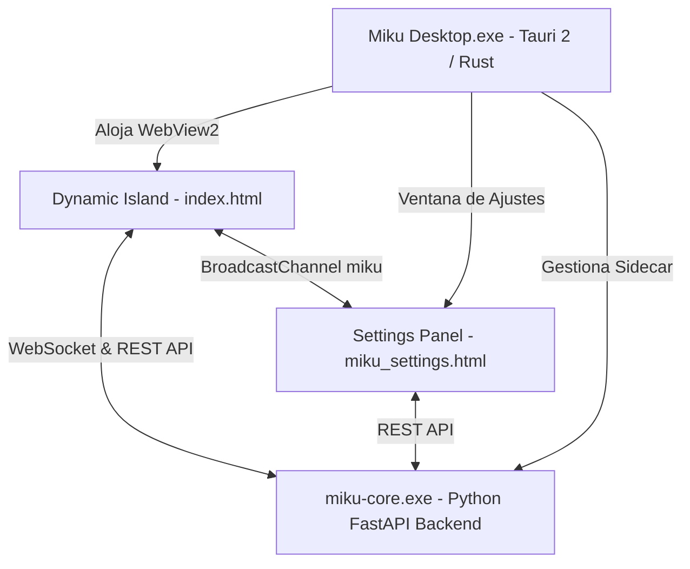

# Interfaz Oficial de Escritorio: Tauri 2 & Dynamic Island 🏝️

La interfaz de escritorio oficial de Miku V2 está desarrollada sobre **Tauri 2** (`miku_ui/`), utilizando un núcleo nativo en Rust y un frontend web ultraligero y acelerado por hardware con micro-animaciones en HTML5 Canvas y SVG.

---

## 🏛️ Arquitectura del Frontend de Escritorio

### 1. Ventana Principal: Dynamic Island (`index.html`)
- **Posicionamiento**: Fijo en la parte superior central de la pantalla principal (`alwaysOnTop`, `decorations: false`, `transparent: true`).
- **Estados Reactivos**:
  - `idle`: Espera interactiva con seguimiento de cursor esférico de Miku.
  - `thinking`: Nube de pensamiento animada con cronómetro de razonamiento en vivo.
  - `working`: Borde cónico animado (1.1px) con gradiente dinámico.
  - `talking` / `listening`: Ondas de voz reactivas al micrófono y al habla.
- **Escenas Principales**:
  - `compact`: Píldora ultra-compacta (128px) que se posa en el borde de la pantalla sin robar el foco.
  - `overview`: Tarjetas 50/50 con métricas del agente activo y reproductor multimedia / cuadrícula 2x2.
  - `prompt` (Chat Multi-Agente): Conversación con Miku o subagentes (GitHub, Antigravity) con burbujas translúcidas, proceso de pensamiento colapsable, historial de comandos colapsable y miniaturas de Computer Use con zoom a pantalla completa.
  - `tool_use`: Monitor de visión y control de periféricos de la computadora.
  - `approve`: Diálogo modal de confirmación con teclado (<kbd>Y</kbd>/<kbd>N</kbd>) para ejecución de comandos sensibles.

### 2. Panel de Configuración (`miku_settings.html`)
- **Navegación por Pestañas**:
  - `General`: Parámetros de la isla, idioma (ES/EN), personalidad y **Actualizador en 1 Clic**.
  - `Voz`: Control de volumen de sintetizador y efectos de sonido con diales continuos, selector de dispositivo de entrada de micrófono y wake word.
  - `Agentes`: Selector y creador de agentes con personalidades aisladas, prompts de sistema y ropa/accesorios personalizados.
  - `Modelos`: Selector jerárquico por proveedor (Google Gemini, Groq, OpenAI, DeepSeek, Anthropic, Ollama) y categorías (Chat, Pro/Código, Computer Use, STT).
  - `Claves de API`: Gestión protegida de variables de entorno `.env`.
  - `MCP`: Catálogo con instalación en un clic y conexión en caliente de servidores Model Context Protocol (`filesystem`, `memory`, `sqlite`, `github`, etc.).
  - `Alertas`: Monitor de tiempo de uso en juegos y aplicaciones estilo Discord con avisos proactivos en la Isla y notificaciones nativas de Windows Toast.
  - `Miku-Link`: Código QR para emparejamiento con la aplicación móvil.

### 3. Comunicación y Puentes (`bridge.js`)
- Gestiona la conexión WebSocket con `ws://127.0.0.1:8000/ws` y peticiones REST seguras.
- Sincroniza el estado entre ventanas mediante la API estándar `BroadcastChannel('miku')`.
- Emite `core_connected` al iniciar el backend para auto-poblar datos sin recargas manuales.

---

## ⚠️ Estado de Interfaces Legado (Fallback)
- **`ui.py` y `widgets/` (PyQt6)**: Interfaz de escritorio legado de versiones tempranas (V1). Se mantiene exclusivamente como referencia histórica o fallback headless. **No debe utilizarse para desarrollo nuevo**.
- **`start_ui.py` (PyWebView)**: Lanzador experimental anterior a la migración a Tauri 2.

---
👉 **Volver al Menú Principal:** [[Home]]
👉 **Ver Arquitectura General:** [[Arquitectura_General]]
