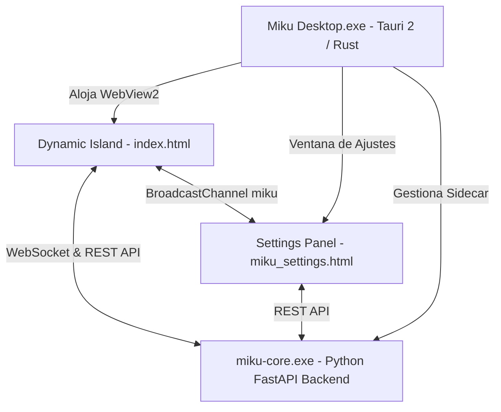

# Interfaz Oficial de Escritorio: Tauri 2 & Dynamic Island 🏝️

La interfaz de escritorio oficial de Miku V2 está desarrollada sobre **Tauri 2** (`miku_ui/`), utilizando un núcleo nativo en Rust y un frontend web ultraligero y acelerado por hardware con micro-animaciones en HTML5 Canvas y SVG.

---

## Fuente del frontend y compatibilidad

El frontend empaquetado por Tauri vive en `miku_ui/src/` y es la fuente canónica. FastAPI todavía monta `miku_island/` en `/island` para los clientes de compatibilidad; esa carpeta no se elimina mientras exista ese montaje.

Los archivos compartidos (`index.html`, `miku_settings.html`, `bridge.js`, `sound_fx.js` y los dos assets de marca) se verifican y sincronizan con:

```powershell
python scripts/sync_island.py
python scripts/sync_island.py --sync
```

La primera orden solo comprueba; la segunda copia desde Tauri hacia el espejo. `miku_island/island.js`, `miku.js` e `island.css` son recursos exclusivos de esa carpeta y siguen pendientes de inventario de consumidores; no forman parte de la sincronización.

La guía de arquitectura y diseño documenta los tokens visuales, el ciclo de animación y la propuesta futura para packs de assets: [[PROJECT_ARCHITECTURE_AND_DESIGN]].

## 🏛️ Arquitectura del Frontend de Escritorio



### 1. Ventana Principal: Dynamic Island (`index.html`)
- **Posicionamiento**: Fijo en la parte superior central de la pantalla principal (`alwaysOnTop`, `decorations: false`, `transparent: true`). La ventana inicia oculta; Tauri define primero tamaño y posición sobre el monitor principal y luego la muestra para evitar un salto visible desde su posición inicial.
- **Estados Reactivos**:
  - `idle`: Espera interactiva con seguimiento de cursor esférico de Miku.
  - `thinking`: Nube de pensamiento animada con cronómetro de razonamiento en vivo.
  - `working`: Borde cónico animado (1.1px) con gradiente dinámico.
  - `talking` / `listening`: Ondas de voz reactivas al micrófono y al habla.
- **Escenas Principales**:
  - `compact`: Píldora ultra-compacta (128px) que se posa en el borde de la pantalla sin robar el foco.
  - `intro` → `boot`: Conserva la entrada de Miku con su burst de partículas Canvas; al terminar, una tarjeta coloca a Miku en el lateral de los indicadores de inicio, preparación de recursos y conexión WebSocket. Incorpora el indicador oficial de Fase Beta activa con acceso directo a reporte de incidencias en GitHub, y sincronización reactiva de idioma en tiempo real (ES, EN, KO) con Ajustes vía `BroadcastChannel`. Solo el handshake real marca el Core como listo y permite continuar al overview.
  - `overview`: Tarjetas 50/50 con métricas del agente activo y reproductor multimedia / cuadrícula 2x2.
  - `prompt` (Chat Multi-Agente): Conversación compacta con Miku o subagentes (GitHub, Antigravity): el canvas animado del agente con su atuendo activo y el nombre permanecen en una columna lateral izquierda; pulsar el avatar abre el agente con notificaciones pendientes. A la derecha se apilan mensaje del usuario, pensamiento colapsable, respuesta y compositor, sin un panel interior para el historial. Incluye historial de comandos y miniaturas de Computer Use con zoom a pantalla completa.
  - `tool_use`: Monitor de visión y control de periféricos de la computadora.
  - `approve`: Diálogo modal de confirmación con teclado (<kbd>Y</kbd>/<kbd>N</kbd>) para ejecución de comandos sensibles.

### 2. Panel de Configuración (`miku_settings.html`)
- **Navegación por Pestañas**:
  - `General`: Parámetros de la isla, idioma (ES/EN), personalidad y **Actualizador en 1 Clic**.
  - `Voz`: Control de volumen de sintetizador y efectos de sonido con diales continuos, selector de dispositivo de entrada de micrófono y wake word.
  - `Agentes`: Selector y creador de agentes con personalidades aisladas, prompts de sistema y ropa/accesorios personalizados.
  - `Modelos`: Selector jerárquico por proveedor (Google Gemini, Groq, OpenAI, DeepSeek, Anthropic, Ollama) y categorías (Chat, Pro/Código, Computer Use, STT).
  - `Claves de API`: Gestión protegida de variables de entorno `.env`.
  - `MCP`: Catálogo con instalación en un clic y conexión en caliente de servidores Model Context Protocol (`filesystem`, `memory`, `sqlite`, `github`, etc.).
  - `Alertas`: Monitor de tiempo de uso en juegos y aplicaciones estilo Discord con avisos proactivos en la Isla y notificaciones nativas de Windows Toast.
  - `Miku-Link`: Código QR para emparejamiento con la aplicación móvil.

### 3. Comunicación y Puentes (`bridge.js`)
- Gestiona la conexión WebSocket con `ws://127.0.0.1:8000/ws` y peticiones REST seguras.
- Sincroniza el estado entre ventanas mediante la API estándar `BroadcastChannel('miku')`.
- Emite `core_connected` al iniciar el backend para auto-poblar datos sin recargas manuales.

### Backend sidecar y desarrollo

La app Tauri inicia `miku-core.exe`, el sidecar compilado desde `server.py`; no hace falta ejecutar el servidor por separado. Editar `server.py` no actualiza un sidecar que ya fue compilado. Tras cerrar completamente Miku Desktop, recompilarlo desde la raíz del repositorio y reconstruir la app de desarrollo:

```powershell
.\venv\Scripts\python.exe scripts\build_sidecar.py
Push-Location miku_ui
npm run tauri -- build --debug --no-bundle
Pop-Location
```

La segunda orden actualiza `miku_ui\src-tauri\target\debug\miku_ui.exe` y su `miku-core.exe`. Antes de volver a abrir la app, comprobar que no haya un backend anterior ocupando el puerto 8000; una instancia existente impide que Tauri inicie el sidecar recién compilado.

Cerrar la ventana principal la oculta en la bandeja y deja el Core disponible para el teléfono. Usa **Abrir Miku** para restaurarla; **Salir** desde el menú de bandeja es el cierre explícito que detiene el sidecar.

La ventana Tauri tiene `shadow: false`; el contorno exterior y el halo CSS de la Isla se mantienen reducidos para no proyectar una sombra amplia.

---

## ⚠️ Estado de Interfaces Legado (Fallback)
- **`ui.py` y `widgets/` (PyQt6)**: Interfaz de escritorio legado de versiones tempranas (V1). Se mantiene exclusivamente como referencia histórica o fallback headless. **No debe utilizarse para desarrollo nuevo**.
- **`start_ui.py` (PyWebView)**: Lanzador experimental anterior a la migración a Tauri 2.

---
👉 **Volver al Menú Principal:** [[Home]]
👉 **Ver Arquitectura General:** [[Arquitectura_General]]
