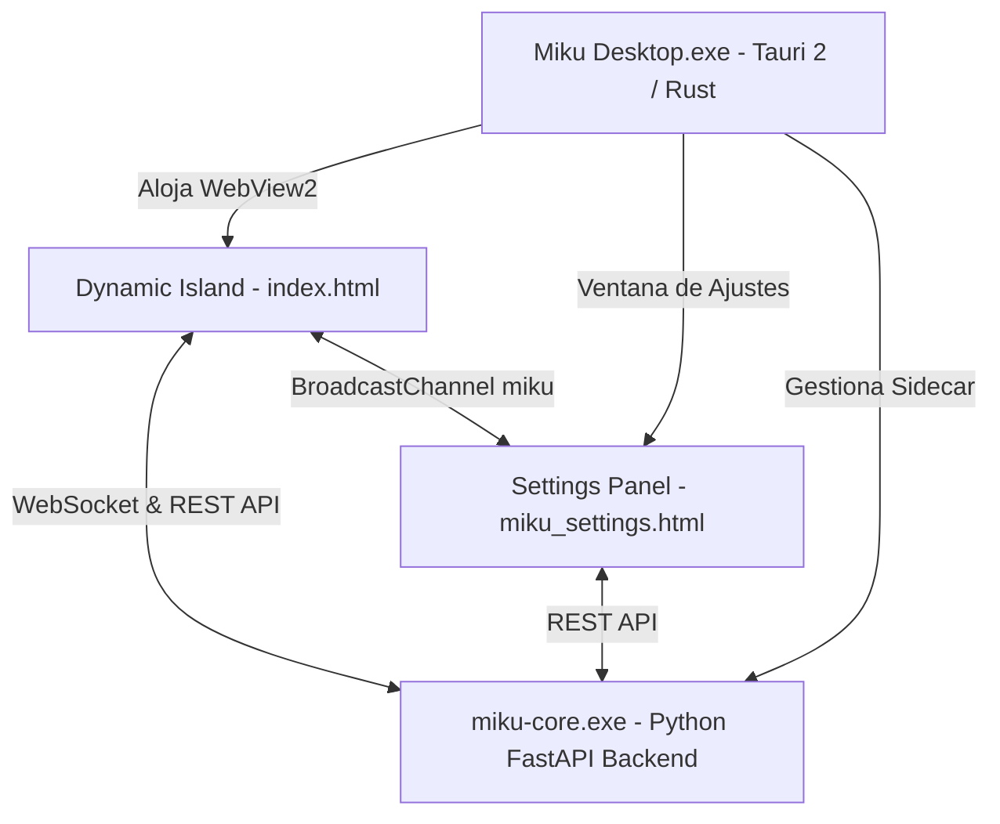

# Interfaz Oficial de Escritorio: Tauri 2 & Dynamic Island 🏝️

La interfaz de escritorio oficial de Miku V2 está desarrollada sobre **Tauri 2** (`miku_ui/`), utilizando un núcleo nativo en Rust y un frontend web ultraligero y acelerado por hardware con micro-animaciones en HTML5 Canvas y SVG.

---

## Fuente del frontend y compatibilidad

El frontend empaquetado por Tauri vive en `miku_ui/src/` y es la fuente canónica. FastAPI todavía monta `miku_island/` en `/island` para los clientes de compatibilidad; esa carpeta no se elimina mientras exista ese montaje.

Los archivos compartidos (`index.html`, `miku_settings.html`, `bridge.js`, `sound_fx.js` y los dos assets de marca) se verifican y sincronizan con:

```powershell
python scripts/sync_island.py
python scripts/sync_island.py --sync
```

La primera orden solo comprueba; la segunda copia desde Tauri hacia el espejo. `miku_island/island.js`, `miku.js` e `island.css` son recursos exclusivos de esa carpeta y siguen pendientes de inventario de consumidores; no forman parte de la sincronización.

La guía de arquitectura y diseño documenta los tokens visuales, el ciclo de animación y la propuesta futura para packs de assets: [[PROJECT_ARCHITECTURE_AND_DESIGN]].

## 🏛️ Arquitectura del Frontend de Escritorio



### 1. Ventana Principal: Dynamic Island (`index.html`)
- **Posicionamiento**: Fijo en la parte superior central de la pantalla principal (`alwaysOnTop`, `decorations: false`, `transparent: true`). La ventana inicia oculta; Tauri define primero tamaño y posición sobre el monitor principal y luego la muestra para evitar un salto visible desde su posición inicial.
- **Estados Reactivos**:
  - `idle`: Espera interactiva con seguimiento de cursor esférico de Miku.
  - `thinking`: Nube de pensamiento animada con cronómetro de razonamiento en vivo.
  - `working`: Borde cónico animado (1.1px) con gradiente dinámico.
  - `talking` / `listening`: Ondas de voz reactivas al micrófono y al habla.
- **Escenas Principales**:
  - `compact`: Píldora ultra-compacta (128px) que se posa en el borde de la pantalla sin robar el foco.
  - `intro` → `boot`: Conserva la entrada de Miku con su burst de partículas Canvas; al terminar, una tarjeta coloca a Miku en el lateral de los indicadores de inicio, preparación de recursos y conexión WebSocket. Incorpora el indicador oficial de Fase Beta activa con acceso directo a reporte de incidencias en GitHub, y sincronización reactiva de idioma en tiempo real (ES, EN, KO) con Ajustes vía `BroadcastChannel`. Solo el handshake real marca el Core como listo y permite continuar al overview.
  - `overview`: Tarjetas 50/50 con métricas del agente activo y reproductor multimedia / cuadrícula 2x2.
  - `prompt` (Chat Multi-Agente): Conversación compacta con Miku o subagentes (GitHub, Antigravity): el canvas animado del agente con su atuendo activo y el nombre permanecen en una columna lateral izquierda; pulsar el avatar abre el agente con notificaciones pendientes. A la derecha se apilan mensaje del usuario, pensamiento colapsable, respuesta y compositor, sin un panel interior para el historial. Incluye historial de comandos y miniaturas de Computer Use con zoom a pantalla completa.
  - `tool_use`: Monitor de visión y control de periféricos de la computadora.
  - `approve`: Diálogo modal de confirmación con teclado (<kbd>Y</kbd>/<kbd>N</kbd>) para ejecución de comandos sensibles.

### 2. Panel de Configuración y Miku-Link (`miku_settings.html`)
- **Arquitectura Visual (`miku-design-system`)**:
  - Ventana libremente redimensionable (`1080×780` por defecto, mínimo `720×520`) con estética monocroma oscura (`#000000` / `--s1: #0e0f11` / `--s2: #17181b`), acento neutro (`--ac: #f5f5f7`), verde único (`--ok: #30d158`) para estados conectados/confirmación y rojo (`--er: #ff453a`) para peligro.
  - Encabezado de sección con motor Canvas `Particles` (aurora multicapa, orbe radial y partículas con matiz `SECTION_HUES` por categoría).
  - Componentes modulares en `miku_ui/src/components/`: `IndicatorNav`, `SmoothSlider` (`requestAnimationFrame`), `HoldButton` (`.hb`), `GlideSelect` y sistema centralizado de internacionalización en español (`miku_ui/src/i18n/es.js`).
- **Secciones Disponibles**:
  - `APLICACIÓN`: `General`, `Agentes`, `Modelos de IA`, `Claves de API`, `Servidores MCP`, `Notificaciones`, `Sonido y voz`, `Apariencia`.
  - `CONECTIVIDAD`: `Miku-Link` (integrado directamente dentro de Configuración, sin ventana externa).
  - `SISTEMA`: `Privacidad`, `Almacenamiento`, `Atajos`, `Acerca de`, `Zona de peligro`.
- **Miku-Link Integrado (`sections/mikuLinkSection.js` + `services/mikuLinkService.js`)**:
  - **Estado 1 — Desconectado (`unpaired`)**: Tarjeta de emparejamiento con ilustración del teléfono, selector segmentado `Código QR` / `Código PIN` de 6 dígitos, temporizador real de 120s sincronizado con `GET /api/link/qr_data` y guía de 3 pasos.
  - **Estado 2 — Emparejando (`linking`)**: Animación de anillos concéntricos, resumen del dispositivo detectado y botón de cancelación (`POST /api/link/cancel_pair`).
  - **Estado 3 — Conectado (`connected`)**: Cabecera del dispositivo con miniatura del teléfono (con soporte de fondo personalizado), telemetría en tiempo real (batería, señal, almacenamiento, estado DND), acciones rápidas (`Hacer sonar`, `Sincronizar`, `Desvincular` con `HoldButton`) y **6 pestañas segmentadas** (`Inicio`, `Mensajes`, `Llamadas`, `Fotos`, `Avisos`, `Apps`) conectadas a `/api/link/*` y WebSocket.

### 4. Rendimiento (0.0% CPU en Reposo) & Dynamic Island Ergonómica
- **Dirty Rendering en Reposo (0.0% CPU en WebView2)**:
  - Cuando Miku está en reposo (`compact` / `idle`) y no hay movimiento del cursor por más de 2.4s, `island.js` suspende el bucle `requestAnimationFrame`, reduciendo el consumo de CPU de WebView2 a 0.0%.
  - Reactivación instantánea ante movimiento del cursor (`pointermove`, `pointerenter`), clics, pulsaciones de teclas, parpadeos programados o mensajes por WebSocket.
- **Dynamic Island para Preguntas y Respuestas Largas**:
  - Marco de ventana nativo Tauri de 800x580 px fijo y transparente, eliminando la recreación destructiva del swapchain DirectX.
  - Tarjeta de chat `#isl` con ancho expandido a 720px y límite ergonómico de altura (`max-height: 480px`) con scrollbar ultra-fino translúcido.
  - Avatar de Miku anclado mediante `position: sticky; top: 10px; align-self: flex-start;`, permaneciendo siempre visible y alineado mientras el usuario lee respuestas extensas o bloques de código.
- **Arranque Escalonado**:
  - Al iniciar, se muestra primero Miku en el centro ejecutando su animación de saludo y burst de partículas.
  - Tras 650ms, la tarjeta de información y estado del Core se expande suavemente hacia la derecha con una transición fluida.
- **Visor e Instalador de Hooks de Agentes en Ajustes (Estilo Coucou)**:
  - Pestaña Agentes con selector de entornos (*Antigravity*, *Claude Code*, *Cursor*, *Gemini CLI*).
  - Tarjeta oscura con diff interactivo (`+`) que muestra exactamente la inyección del hook para el agente seleccionado.
  - Botón de instalación en 1 clic con leyenda de seguridad que certifica que no se modifica ninguna otra clave ni configuración personal.
- **Silenciamiento de Servicio en Android**:
  - Canal de Foreground Service en `NotificationManager.IMPORTANCE_LOW` silencioso en `MikuConnectionService.kt`, reservando alertas con sonido únicamente para transferencias de archivos o aprobaciones del usuario.

### 5. Integración con el Explorador de Windows (Menú Contextual & SendTo)
- **Compartir al Celular**: Al dar clic derecho sobre cualquier archivo o carpeta en Windows, aparece la opción **"Enviar a Mi teléfono (Miku)"** con el ícono oficial de Miku-Link.
- **Doble Registro Nativo**:
  - `HKCU\Software\Classes\*\shell\MikuSendToPhone` y `Software\Classes\Directory\shell\MikuSendToPhone`.
  - Acceso directo en la carpeta `SendTo` (`shell:sendto`), apareciendo tanto en el menú moderno como en el submenú "Enviar a".
  - Despacha una petición HTTP a `POST /api/desktop/send_file_to_phone`, la cual avisa a la Isla Dinámica y transfiere inmediatamente el recurso al companion móvil.

### 6. Comunicación y Puentes (`bridge.js`)
- Gestiona la conexión WebSocket con `ws://127.0.0.1:8000/ws` y peticiones REST seguras.
- Sincroniza el estado entre ventanas mediante la API estándar `BroadcastChannel('miku')`.
- Emite `core_connected` al iniciar el backend para auto-poblar datos sin recargas manuales.

### Backend Sidecar y Arquitectura `--onedir` (Arranque Instantáneo en ~1s)

La app Tauri inicia `miku-core.exe`, el sidecar compilado desde `server.py`:
- **Migración a `--onedir`**: PyInstaller empaqueta el backend en modo directorio (`--onedir`) en lugar de ejecutable único (`--onefile`). Esto evita la extracción temporal de ~150MB en `AppData\Local\Temp\_MEIxxxxxx` en cada lanzamiento, reduciendo el arranque de más de 20 segundos a **menos de 1 segundo**.
- **Despliegue y Rutas**:
  - Los binarios se compilan en `binaries/miku-core/` y se copian automáticamente a `%LOCALAPPDATA%\Miku Desktop\miku-core\`.
  - El instalador NSIS (`hooks.nsi` y `tauri.conf.json`) incluye los recursos y despliega la carpeta en `%LOCALAPPDATA%`.
  - Al iniciar, Tauri (`lib.rs`) comprueba primero `%LOCALAPPDATA%\Miku Desktop\miku-core\miku-core.exe`, ejecutándolo en su propio directorio de trabajo de forma instantánea.

Comandos de compilación:

```powershell
.\venv\Scripts\python.exe scripts\build_sidecar.py
Push-Location miku_ui
npm run tauri -- build --debug --no-bundle
Pop-Location
```

La segunda orden actualiza `miku_ui\src-tauri\target\debug\miku_ui.exe` y sus dependencias. Antes de volver a abrir la app, comprobar que no haya un backend anterior ocupando el puerto 8000.

Cerrar la ventana principal la oculta en la bandeja y deja el Core disponible para el teléfono. Usa **Abrir Miku** para restaurarla; **Salir** desde el menú de bandeja es el cierre explícito que detiene el sidecar.

La ventana Tauri tiene `shadow: false`; el contorno exterior y el halo CSS de la Isla se mantienen reducidos para no proyectar una sombra amplia.

---

## ⚠️ Estado de Interfaces Legado (Fallback)
- **`ui.py` y `widgets/` (PyQt6)**: Interfaz de escritorio legado de versiones tempranas (V1). Se mantiene exclusivamente como referencia histórica o fallback headless. **No debe utilizarse para desarrollo nuevo**.
- **`start_ui.py` (PyWebView)**: Lanzador experimental anterior a la migración a Tauri 2.

---
👉 **Volver al Menú Principal:** [[Home]]
👉 **Ver Arquitectura General:** [[Arquitectura_General]]
